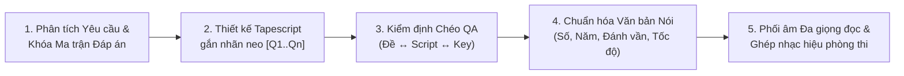

# Quy Chuẩn Tạo File Nghe MP3 Tiếng Anh Chuẩn Khảo Thí (Khớp 100% Câu Hỏi)

> **BẮT BUỘC ĐỌC TRƯỚC KHI TẠO FILE NGHE MP3 HOẶC RA ĐỀ TIẾNG ANH CÓ PHẦN LISTENING.**
> Tài liệu này quy định **Kế hoạch Đồng bộ hóa Ngược 5 Bước (5-Step Backward Synchronization Plan)** để bảo đảm file âm thanh MP3 xuất ra khớp tuyệt đối 100% với câu hỏi trên đề và bảng đáp án.

---

## 🗺️ SƠ ĐỒ QUY TRÌNH ĐỒNG BỘ HÓA 5 BƯỚC



---

## 📋 PHẦN 1: 3 KỊCH BẢN ĐẦU VÀO THỰC TẾ CỦA GIÁO VIÊN

| Kịch bản đầu vào | Phương pháp xử lý bắt buộc để MP3 khớp 100% câu hỏi |
| :--- | :--- |
| **Trường hợp 1:**<br>Đã có sẵn **Câu hỏi trên đề + Đáp án**, nhưng **mất file nghe / chưa có Tapescript** | **Tái tạo ngược (Reverse Scripting):** Phân tích từng câu hỏi và phương án đúng/sai $\rightarrow$ Viết Tapescript chứa đầy đủ bằng chứng đáp án đúng (`[Q1]..[Qn]`) và gài bẫy hợp lý các phương án nhiễu theo đúng thứ tự từ câu đầu đến câu cuối $\rightarrow$ Kiểm định QA $\rightarrow$ Xuất MP3. |
| **Trường hợp 2:**<br>Mới chỉ có **Form đề / Ma trận** (ví dụ Form HSG Lớp 9, Đề thi vào 10, THPT) | **Thiết kế song hành (Co-Design):** Viết Tapescript học thuật gắn nhãn `[Q1]..[Qn]` trước $\rightarrow$ Trích xuất câu hỏi trực tiếp từ các mốc thông tin trong Tapescript $\rightarrow$ Đối chiếu khớp 100% với bảng Key $\rightarrow$ Xuất đồng thời Đề Word (`.docx`) + File nghe (`.mp3`). |
| **Trường hợp 3:**<br>Đã có sẵn **Tapescript (bản chữ)** trong sách/đề gốc, cần chuyển thành file MP3 | **Chuyển thể nguyên bản (Verbatim Studio Production):** Giữ nguyên 100% câu chữ trong Tapescript của giáo viên $\rightarrow$ Phân vai giọng đọc Nam/Nữ phù hợp ngữ cảnh $\rightarrow$ Chèn nhạc hiệu, lời dẫn và khoảng nghỉ đúng quy chế $\rightarrow$ Xuất MP3. |

---

## 🛠️ PHẦN 2: KẾ HOẠCH 5 BƯỚC KỸ THUẬT BẮT BUỘC

### Bước 1: Thiết lập "Bảng Neo Đáp Án" (Anchor-Point Mapping)
Mỗi câu hỏi nghe (`Q1` đến `Qn`) bắt buộc phải được khóa chặt bằng 3 thành phần trong Tapescript:
1. **Từ khóa dẫn đường (Signposting words)**: Từ vựng xuất hiện quanh câu hỏi trên giấy để học sinh biết băng đang đọc đến câu số mấy.
2. **Bằng chứng đáp án đúng (Target Evidence)** gắn nhãn `[Q1]`, `[Q2]`...:
   - Với **Trắc nghiệm (MCQ)**: Dùng từ đồng nghĩa / cấu trúc tương đương (paraphrase) với phương án đúng.
   - Với **True / False**: Câu `True` phải đồng nghĩa rõ ràng với nhận định; câu `False` phải có từ đối lập trực tiếp (ví dụ: *less than 5mm* >< *over 5cm*).
   - Với **Điền từ vào ghi chú (Gap-fill / Note completion)**: Từ cần điền phải xuất hiện **nguyên văn 100% (verbatim)** trong câu thoại tại vị trí `[Qn]`.
3. **Bẫy phương án nhiễu (Distractor Traps)**: Nhắc đến các phương án sai nhưng phủ định khéo léo bằng *however, instead of, while ... is optional, no longer, used to...*

### Bước 2: Quy tắc "Trình tự Tuyến tính" (Strict Linear Order)
- Thông tin trả lời từ **Câu 1 $\rightarrow$ Câu cuối** trong từng Part **bắt buộc phải xuất hiện lần lượt theo đúng thứ tự thời gian từ đầu đến cuối**.
- Tuyệt đối không để thông tin câu sau xuất hiện trước câu trước.
- Với bài **Gap-fill**: Kiểm tra số lượng từ của đáp án không vượt quá giới hạn đề bài (ví dụ: *NO MORE THAN THREE WORDS AND/OR A NUMBER* $\rightarrow$ `max_words = 3`).

### Bước 3: Chuẩn hóa "Văn bản Nói" (Spoken-Text Normalization)
Sử dụng class `SpokenTextNormalizer` trong `scripts/english_listening_mp3_builder.py` để tự động xử lý văn bản trước khi đưa vào bộ tổng hợp giọng nói:
- Tự động xóa sạch các nhãn `[Q1]`, `(Q2 - B)` để máy thu âm không đọc lộ nhãn câu hỏi vào bài nghe.
- Chuyển tiền tệ `$60` $\rightarrow$ `"60 dollars"`, phần trăm `20%` $\rightarrow$ `"20 percent"`, số thứ tự `7th` $\rightarrow$ `"seventh"`.
- Chuyển chức danh viết tắt `Dr.` $\rightarrow$ `"Doctor"`, `Prof.` $\rightarrow$ `"Professor"`, `Mr.` $\rightarrow$ `"Mister"`.
- Hỗ trợ đánh vần tên riêng qua cú pháp `[SPELL: MARYKIRK]` $\rightarrow$ `"M, A, R, Y, K, I, R, K"`.
- Điều chỉnh tốc độ đọc (`level`) theo đúng cấp học:
  - `grade_6_7`: `rate="-10%"` (~115–125 WPM)
  - `grade_8_9`: `rate="-5%"` (~130–140 WPM)
  - `hsg_9` / `hsg_thpt`: `rate="+0%"` (~150–160 WPM chuẩn bản xứ)
  - `thpt`: `rate="-3%"` (~140–150 WPM)

### Bước 4: Kiểm định Chéo Tự Động (Cross-Audit QA Gate)
Trước khi sinh âm thanh MP3, bắt buộc chạy `ListeningSyncValidator.validate_spec(spec)` (tích hợp sẵn trong `scripts/english_listening_mp3_builder.py`):
- Kiểm tra đủ 100% nhãn `[Q1]..[Qn]` khớp với danh sách câu hỏi.
- Kiểm tra thứ tự xuất hiện các nhãn `[Q1] < [Q2] < ... < [Qn]` tăng dần nghiêm ngặt.
- Kiểm tra toàn bộ từ điền khuyết (Gap-fill) có mặt thực tế trong Tapescript và đúng giới hạn số từ.
- Chỉ khi báo cáo QA đạt **`ĐẠT CHUẨN 100%`** thì mới tiến hành tổng hợp MP3.

### Bước 5: Phối âm Phòng thu Đa giọng đọc & Đóng gói Chuẩn Quy chế Thi
Sử dụng công cụ `scripts/english_listening_mp3_builder.py` (kết hợp **Microsoft Edge Neural Voices** + **Pydub/FFmpeg**):
- **Bảng phân vai giọng đọc bản xứ (`VOICE_PRESETS`)**:
  - `announcer`: `en-GB-SoniaNeural` (Giám thị / Phát thanh viên dẫn quy chế chuẩn Anh - Anh RP)
  - `female_uk`: `en-GB-LibbyNeural` (Nữ Anh - Anh)
  - `male_uk`: `en-GB-RyanNeural` (Nam Anh - Anh)
  - `female_us`: `en-US-JennyNeural` (Nữ Anh - Mỹ)
  - `female_academic`: `en-US-AriaNeural` (Nữ Anh - Mỹ học thuật)
  - `male_us`: `en-US-GuyNeural` (Nam Anh - Mỹ trầm ấm, chuẩn Giáo sư giảng bài)
- **Cấu trúc âm thanh phòng thi tự động cho mỗi Part**:
  $$\text{Lời dẫn Part} \rightarrow \text{Nghỉ đọc đề (30s–45s)} \rightarrow \text{Nhạc hiệu (Beep)} \rightarrow \mathbf{\text{Nghe Lần 1}} \rightarrow \text{Nghỉ (15s)} \rightarrow \text{"Now listen again"} \rightarrow \mathbf{\text{Nghe Lần 2}} \rightarrow \text{Nghỉ kiểm tra (20s)}$$
- **Luôn xuất đồng thời 2 bộ file**:
  1. **1 File Master duy nhất** (`<TEN_DE>_FULL_LISTENING.mp3`): Gồm toàn bộ bài thi nghe từ đầu đến cuối để bật 1 click trong phòng thi.
  2. **Các File lẻ từng Part** (`SECTION_I_PART_1_LISTENING.mp3`, `Part_2...`, `Part_3...`): Để giáo viên mở lẻ khi dạy hoặc chữa bài trên lớp.

---

## 💻 PHẦN 3: CÁCH GỌI CÔNG CỤ `english_listening_mp3_builder.py`

### Cách 1: Gọi trực tiếp qua CLI từ file JSON đặc tả
```bash
# Kiểm định đồng bộ QA Gate trước:
python "<ĐƯỜNG_DẪN_SKILL>/scripts/english_listening_mp3_builder.py" --spec listening_spec.json --validate-only

# Tạo trọn bộ file MP3 (Master + từng Part):
python "<ĐƯỜNG_DẪN_SKILL>/scripts/english_listening_mp3_builder.py" --spec listening_spec.json --out "./listening_audio"
```

### Cách 2: Cấu trúc mẫu `listening_spec.json`
```json
{
  "level": "hsg_9",
  "play_count": 2,
  "master_filename": "DE_THI_HSG9_TIENG_ANH_FULL_LISTENING.mp3",
  "intro_text": "Department of Education and Training. Grade 9 English Listening Test. Each part will be played twice.",
  "parts": [
    {
      "title": "Part 1",
      "type": "mcq",
      "filename": "SECTION_I_PART_1_LISTENING.mp3",
      "pre_pause_sec": 30,
      "between_pause_sec": 15,
      "post_pause_sec": 20,
      "instruction": "Part One. Questions 1 to 5. Choose the correct answer A, B, C, or D.",
      "questions": [
        {"id": 1, "answer": "B"},
        {"id": 2, "answer": "B"}
      ],
      "segments": [
        {
          "voice": "female_uk",
          "text": "Good morning! Our field trip to Cat Ba National Park focuses on studying marine biodiversity and mangrove ecosystems [Q1]. After the school subsidy, each student only pays $60 [Q2]."
        }
      ]
    },
    {
      "title": "Part 3",
      "type": "gapfill",
      "max_words": 3,
      "filename": "SECTION_I_PART_3_LISTENING.mp3",
      "pre_pause_sec": 45,
      "between_pause_sec": 20,
      "post_pause_sec": 20,
      "instruction": "Part Three. Complete the notes below. Write NO MORE THAN THREE WORDS AND/OR A NUMBER.",
      "questions": [
        {"id": 11, "answer": "7th / seventh"},
        {"id": 12, "answer": "vertical"}
      ],
      "segments": [
        {
          "voice": "male_us",
          "text": "The earliest windmills were built in Persia around the 7th [Q11] century and operated around a vertical [Q12] axis."
        }
      ]
    }
  ]
}
```
