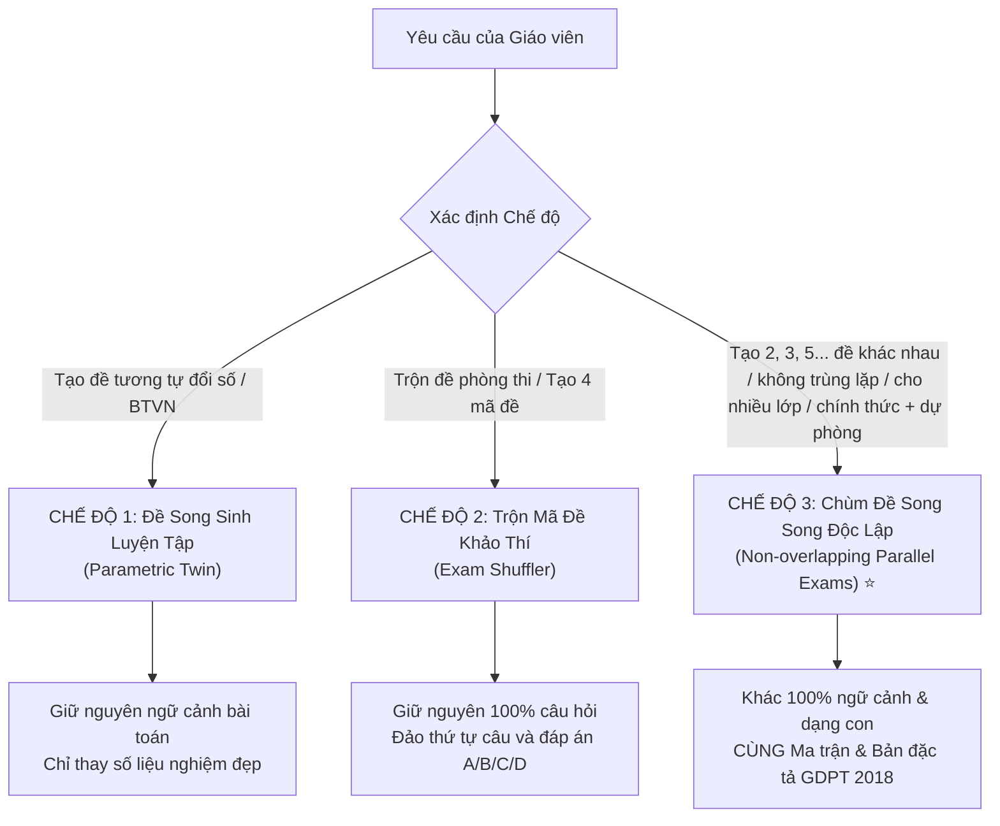

# Bước 2 — Thiết kế số liệu theo độ khó & Kiểm định chuẩn GDPT 2018 (checklist đầy đủ)

> Đọc khi thiết kế đề tương tự (bảng điều chỉnh số liệu, tỷ lệ NB/TH/VD/VDC) và trước khi xuất đề (Bước 2bis — bắt buộc).
> *(Tài liệu tham chiếu của skill `tao-de-toan-tuong-tu` — được tách ra từ `SKILL.md` để SKILL.md gọn; nội dung quy tắc giữ nguyên.)*

---

### Bước 2: Thiết kế bài toán tương đương & Kiểm định toán học / khoa học

---

#### 🎯 Bước 2.0 – Xác định Mục đích & 3 Chế Độ Biên Soạn Đề (MANDATORY – BẮT BUỘC ĐẦU TIÊN)

Trước khi bắt tay vào thiết kế câu hỏi, Agent PHẢI xác định rõ yêu cầu của Thầy/Cô thuộc chế độ nào trong **3 Chế độ Khảo thí Chuẩn**:



| Chế độ | Mục đích sử dụng của Giáo viên | Quy tắc cốt lõi về Nội dung & Cấu trúc |
|:---|:---|:---|
| **Chế độ 1: Đề song sinh luyện tập** *(Parametric Twin)* | Giao bài tập về nhà sau giờ học, rèn luyện kỹ năng tính toán cùng một dạng bài. | Cùng văn cảnh, cùng dạng bài toán con, chỉ thay đổi tham số/số liệu nghiệm đẹp. |
| **Chế độ 2: Trộn mã đề phòng thi** *(Exam Shuffler)* | Dùng trong **cùng 1 phòng thi** để chống học sinh ngồi cạnh nhìn bài nhau. | Giữ nguyên bộ câu hỏi, hoán vị vị trí câu và hoán vị phương án A/B/C/D qua `exam_shuffler.py`. |
| **Chế độ 3: Chùm đề song song độc lập** *(Non-overlapping Parallel Exams)* ⭐ | **Kiểm tra các lớp khác nhau (12A1, 12A2...), các ca thi khác nhau, kiểm tra tuần 1/2/3/4/5, hoặc Đề chính thức + Đề dự bị.** | **KHÔNG TRÙNG LẶP 100%**: Khác biệt hoàn toàn về ngữ cảnh, câu chuyện thực tế, đối tượng khảo sát và dạng bài toán con. Tuyệt đối **KHÔNG** đảo câu, **KHÔNG** sao chép đổi số. **ĐỒNG NHẤT 100%** về Ma trận & Bản đặc tả chuẩn GDPT 2018. |

---

#### 🌟 NGUYÊN TẮC VÀNG CHO CHẾ ĐỘ 3: CHÙM ĐỀ SONG SONG ĐỘC LẬP (TẤT CẢ CÁC MÔN)

Khi Thầy/Cô yêu cầu tạo từ 2 đề trở lên không trùng lặp, Agent **BẮT BUỘC TUÂN THỦ 6 TIÊU CHUẨN KHẢO THÍ**:

1. **Chuẩn hóa Đẳng cấu Ma trận (Matrix Equivalence)**:
   - Tất cả các đề trong chùm đề đều bám sát 100% cùng một Khung Ma trận và Bản đặc tả.
   - Cùng số lượng câu hỏi ở từng phần (Phần I trắc nghiệm nhiều lựa chọn, Phần II trắc nghiệm đúng/sai, Phần III trả lời ngắn / Tự luận).
   - Tỷ lệ cấp độ nhận thức đồng nhất tuyệt đối: Nhận biết (~30%), Thông hiểu (~40%), Vận dụng (~20%), Vận dụng cao (~10%).
   - Thời gian làm bài dự kiến và độ phức tạp tư duy tương đương nhau ($\Delta \text{Độ khó} \le 5\%$), đảm bảo công bằng tuyệt đối cho học sinh ở các lớp/ca thi khác nhau.

2. **Đa dạng hóa Ngữ cảnh Thực tế 100% (Context & Scenario Diversity)**:
   - **Nghiêm cấm tuyệt đối**: Dùng chung một cốt truyện bài toán rồi chỉ thay con số (ví dụ: Đề 1 "bể nước hình trụ cao 2m", Đề 2 "bể nước hình trụ cao 3m" là **VI PHẠM**).
   - Mỗi đề phải xây dựng một bài toán với ngữ cảnh thực tiễn hoàn toàn độc lập (kinh tế, kỹ thuật, môi trường, y tế, đời sống, giao thông, công nghệ, vũ trụ...).

3. **Phân rã Ma trận thành các Nhánh con Độc lập (Sub-skill Branching)**:
   - Trong cùng một yêu cầu cần đạt (chuẩn kiến thức), Agent luân chuyển các phân nhánh độc lập khác nhau cho từng đề.

4. **Đa dạng hóa Kênh biểu diễn Thông tin (Representation Diversity)**:
   - Cùng kiểm tra năng lực tư duy dữ liệu: Đề 1 dùng Đồ thị $\leftrightarrow$ Đề 2 dùng Bảng biến thiên / Bảng số liệu $\leftrightarrow$ Đề 3 dùng Mô hình hình học trực quan $\leftrightarrow$ Đề 4 dùng Diễn giải thực tế $\leftrightarrow$ Đề 5 dùng Biểu thức giải tích.

5. **Chỉ số Tương đồng Liên đề $\le 20\%$ (Cross-Exam Anti-collision Index)**:
   - Giữa câu hỏi số $i$ của Đề $A$ và Đề $B$, chỉ số giao thoa từ khóa và mô hình bài toán không được vượt quá $20\%$. Học sinh không thể áp dụng máy móc mẹo giải hay kết quả của đề này sang đề kia.

6. **Lập Bảng đối sánh Chùm đề (Cross-Exam Comparison Table)**:
   - Luôn tổng hợp bảng đối sánh chi tiết để Thầy/Cô và Tổ chuyên môn dễ dàng thẩm định sự công bằng và tính đa dạng của từng đề.

---

#### 📚 BẢNG HƯỚNG DẪN PHÂN NHÁNH ĐA DẠNG HÓA CHO TẤT CẢ CÁC MÔN HỌC

##### 🔵 1. Môn Toán (Lớp 6 – 12):
* **Chủ đề Khảo sát Hàm số & Đạo hàm (Lớp 12):**
  * *Đề 1:* Đọc bảng biến thiên tìm điểm cực trị của hàm phân thức bậc 2/bậc 1.
  * *Đề 2:* Cho đồ thị đạo hàm $y = f'(x)$, xét tính đơn điệu của hàm hợp $g(x) = f(2 - x)$.
  * *Đề 3:* Ứng dụng thực tế: Tối ưu hóa dung tích thùng chứa hàng hình hộp chữ nhật có nắp mở.
  * *Đề 4:* Tìm tham số $m$ để hàm số bậc ba đồng biến trên khoảng $(0; +\infty)$.
  * *Đề 5:* Đồ thị hàm phân thức bậc nhất/bậc nhất gắn với bài toán chi phí biên trong kinh tế.
* **Chủ đề Hình học Không gian & Tọa độ Oxyz:**
  * *Đề 1:* Bài toán khoảng cách từ điểm đến mặt phẳng trong khối chóp có đáy là hình vuông.
  * *Đề 2:* Góc giữa hai mặt phẳng trong khối lăng trụ đứng tam giác.
  * *Đề 3:* Oxyz mô phỏng tọa độ trạm phát sóng radar và vị trí máy bay thương mại.
  * *Đề 4:* Thể tích khối đa diện gắn với thiết kế mái vòm nhà thi đấu thể thao.
  * *Đề 5:* Mặt cầu trong Oxyz gắn với quỹ đạo vệ tinh địa tĩnh quanh Trái Đất.
* **Chủ đề Thống kê & Xác suất:**
  * *Đề 1:* Xác suất có điều kiện trong xét nghiệm y tế chẩn đoán bệnh.
  * *Đề 2:* Phân phối nhị thức trong kiểm định chất lượng dây chuyền sản xuất chip bán dẫn.
  * *Đề 3:* Biến ngẫu nhiên rời rạc gắn với bài toán bảo hiểm xe cơ giới.
  * *Đề 4:* Thống kê mẫu số liệu ghép nhóm về mức thu nhập của người lao động.
  * *Đề 5:* Xác suất cổ điển gắn với trò chơi truyền hình có thưởng.

##### 🔴 2. Môn Vật Lý (Lớp 10 – 12):
* **Chủ đề Động lực học & Định luật bảo toàn:**
  * *Đề 1:* Va chạm mềm giữa hai toa tàu hỏa trên đường ray vận chuyển than.
  * *Đề 2:* Hiện tượng súng giật lùi khi bắn đạn pháo trong huấn luyện quân sự.
  * *Đề 3:* Chuyển động phản lực của tên lửa nước trong hoạt động STEM học sinh.
  * *Đề 4:* Người nhảy từ thuyền nhỏ lên cầu tàu làm thuyền bị đẩy dạt ra xa.
  * *Đề 5:* Hai xe đệm khí va chạm đàn hồi trên đệm không khí trong phòng thí nghiệm.
* **Chủ đề Dao động & Sóng:**
  * *Đề 1:* Đồ thị li độ - thời gian của con lắc lò xo treo thẳng đứng.
  * *Đề 2:* Bảng số liệu thực nghiệm đo gia tốc trọng trường bằng con lắc đơn.
  * *Đề 3:* Giao thoa sóng nước từ hai nguồn kết hợp gắn với hiện tượng sóng biển ở cửa sông.
  * *Đề 4:* Sóng âm trong ống cộng hưởng và ứng dụng chế tạo nhạc cụ sáo trúc.
  * *Đề 5:* Dao động tắt dần của giảm xóc xe máy khi đi qua gờ giảm tốc.

##### 🟢 3. Môn Hóa Học (Lớp 10 – 12):
* **Chủ đề Hóa học Hữu cơ (Este - Lipit - Xà phòng):**
  * *Đề 1:* Phản ứng xà phòng hóa tristearin trong mỡ bò thu được muối dùng làm xà phòng bánh.
  * *Đề 2:* Phản ứng điều chế este benzyl axetat có mùi thơm hoa nhài dùng trong công nghiệp nước hoa.
  * *Đề 3:* Phản ứng este hóa giữa axit béo chưa no trong dầu thực vật với methanol sản xuất nhiên liệu sinh học (biodiesel).
  * *Đề 4:* Bài toán thủy phân hỗn hợp vinyl axetat và etyl fomat trong môi trường kiềm.
  * *Đề 5:* Quy trình tinh chế dầu ăn và xử lý mùi hôi bằng phương pháp hóa học xanh.
* **Chủ đề Tốc độ Phản ứng & Cân bằng Hóa học:**
  * *Đề 1:* Ảnh hưởng của nồng độ đến tốc độ phản ứng giữa Na2S2O3 và H2SO4 (thực nghiệm đục dung dịch).
  * *Đề 2:* Cân bằng tổng hợp amoniac (quá trình Haber-Bosch) và nguyên lý chuyển dịch Le Chatelier theo áp suất.
  * *Đề 3:* Phản ứng phân hủy H2O2 xúc tác bởi MnO2 gắn với quá trình xử lý nước thải.
  * *Đề 4:* Đồ thị nhiệt độ ảnh hưởng đến cân bằng tạo khí NO2 nâu đỏ từ N2O4 không màu.
  * *Đề 5:* Tốc độ ăn mòn kim loại của vỏ tàu biển trong nước biển chứa muối.

##### 🟣 4. Môn Sinh Học (Lớp 10 – 12):
* **Chủ đề Di truyền học:**
  * *Đề 1:* Phả hệ di truyền bệnh máu khó đông (Hemophilia) liên kết NST giới tính X ở người.
  * *Đề 2:* Lai hai cặp tính trạng phân ly độc lập ở cây cà chua (màu quả và dạng quả).
  * *Đề 3:* Di truyền liên kết gen hoàn toàn và hoán vị gen ở ruồi giấm (Drosophila melanogaster).
  * *Đề 4:* Tác động đa hiệu của gen gây bệnh thiếu máu hồng cầu hình liềm.
  * *Đề 5:* Tương tác gen bổ sung trong hình thành màu hoa ở cây đậu thơm.

##### 🌍 5. Môn Khoa Học Tự Nhiên (KHTN Lớp 6 – 9):
* Luôn bảo đảm tích hợp cân đối giữa 3 phân môn Vật lý (Chất và sự biến đổi), Hóa học (Vật chất), và Sinh học (Vật sống):
  * *Đề 1:* Trọng tâm: Năng lượng tái tạo & Hiệu ứng nhà kính (pin mặt trời, quang hợp, khí thải CO2).
  * *Đề 2:* Trọng tâm: Nguồn nước sạch & Quá trình lọc nước sinh hoạt (tách chất, thẩm thấu, vi sinh vật).
  * *Đề 3:* Trọng tâm: An toàn thực phẩm & Dinh dưỡng (bảo quản thức ăn, phản ứng lên men, tiêu hóa ở người).
  * *Đề 4:* Trọng tâm: Khí quyển & Dự báo thời tiết (áp suất khí quyển, độ ẩm, bay hơi, vòng tuần hoàn của nước).
  * *Đề 5:* Trọng tâm: Rác thải nhựa & Kinh tế tuần hoàn (phân loại rác, phân hủy sinh học, vật liệu polyme mới).

##### 🇬🇧 6. Môn Tiếng Anh (Lớp 6 – 12):
* Cùng khung ma trận (Ngữ âm, Ngữ pháp, Từ vựng, Điền từ đoạn văn Cloze Test, Đọc hiểu Reading, Viết lại câu):
  * *Đề 1:* Bài đọc về **Trí tuệ Nhân tạo & Tương lai của nghề nghiệp** (Artificial Intelligence in Modern Jobs).
  * *Đề 2:* Bài đọc về **Biến đổi khí hậu & Đô thị thông minh** (Climate Change and Eco-friendly Smart Cities).
  * *Đề 3:* Bài đọc về **Bảo tồn Di sản Văn hóa & Lối sống xanh** (Preserving Cultural Heritage in the Digital Age).
  * *Đề 4:* Bài đọc về **Khám phá Không gian & Du hành vũ trụ** (Space Exploration and Planetary Missions).
  * *Đề 5:* Bài đọc về **Sức khỏe Tinh thần & Cân bằng Cuộc sống** (Mental Health and Digital Detox for Teens).
  * *(File nghe MP3 tự động đọc bài nghe riêng biệt khớp 100% từng câu hỏi của từng đề).*

##### 📜 7. Các Môn Xã Hội (Ngữ văn, Lịch sử, Địa lý, KTPL, Tin học, Công nghệ):
* **Ngữ văn:** Tuyệt đối không dùng chung ngữ liệu; mỗi đề chọn một văn bản/đoạn trích ngoài SGK hoàn toàn khác nhau cùng thể loại.
* **Lịch sử & Địa lý:** Các bảng số liệu, biểu đồ kinh tế xã hội, lược đồ các trận đánh hoặc các giai đoạn lịch sử luân chuyển độc lập.
* **KTPL (Kinh tế & Pháp luật):** Các tình huống tranh chấp hợp đồng, nghĩa vụ thuế, quyền tiêu dùng, pháp luật lao động khác nhau 100% về nhân vật và bối cảnh.

---

#### ⚖️ Điều chỉnh Độ Khó Tổng Thể (Khi Thầy/Cô yêu cầu chỉnh mức độ):

Nếu Thầy/Cô có yêu cầu thêm về mức độ (dễ hơn hoặc khó hơn):

| Yêu cầu của Giáo viên | Phân loại `difficulty_level` | Tỷ lệ NB : TH : VD : VDC | Hướng dẫn điều chỉnh |
|---|---|---|---|
| (Mặc định / Tương đương) | `equivalent` | **30% : 40% : 20% : 10%** | Giữ đúng chuẩn GDPT 2018 theo Bản đặc tả gốc. |
| "Dễ hơn", "cho lớp cơ bản" | `easier` | **40% : 40% : 15% : 5%** | Giảm số bước tính toán, số liệu nguyên gọn, ưu tiên câu suy luận đơn bước. |
| "Khó hơn", "cho học sinh giỏi" | `harder` | **20% : 30% : 25% : 25%** | Tăng bài toán liên môn, phương án nhiễu tinh vi, đòi hỏi tư duy phân tích sâu. |

---


### ✅ Bước 2bis: Kiểm Định Chuẩn GDPT 2018 (BẮT BUỘC TRƯỚC KHI XUẤT ĐỀ)

> [!IMPORTANT]
> **CHỈ THỊ BẮT BUỘC:** Sau khi thiết kế xong toàn bộ câu hỏi, Agent PHẢI tự kiểm tra checklist dưới đây. Nếu bất kỳ mục nào KHÔNG ĐẠT, phải sửa trước khi xuất file Word.

#### Checklist Kiểm Định Tự Động (8 môn, lớp 6–12):

```
✅ CHECKLIST GDPT 2018
══════════════════════════════════════════════════════════════════════

□ [CẤU TRÚC] Đề có đủ 3 phần theo chuẩn GDPT 2018?
  - Môn KHTN/Toán/Lý/Hóa/Sinh/Địa/KTPL: Phần I + II + III (+ Tự luận nếu là đề học kỳ)
  - Môn Ngữ Văn: Đọc hiểu + Viết (KHÔNG có trắc nghiệm A/B/C/D)

□ [ĐÚNG/SAI] Mỗi câu Phần II có ĐÚNG 4 ý a/b/c/d không?
  - Ý a: mức NB | Ý b: mức TH | Ý c: mức VD | Ý d: mức VDC
  - Không được tất cả 4 ý đều ĐÚNG hoặc đều SAI

□ [TỈ LỆ NB/TH/VD/VDC] Tổng tỉ lệ trên toàn đề xấp xỉ 30:40:20:10 (%)?

□ [TRẢ LỜI NGẮN] Tất cả đáp án Phần III là số nguyên hoặc thập phân ≤ 2 chữ số?

□ [THỰC TIỄN] Có ít nhất 1–2 câu mang ngữ cảnh đời sống thực tế?

□ [TỰ LUẬN] Lời giải tự luận có bước "phiên giải kết quả về thực tiễn"?

□ [PHƯƠNG PHÁP GIẢI GDPT 2018] Lời giải TUYỆT ĐỐI không dùng phương pháp cũ (2006):
  - Toán: Đủ 4 bước mô hình hóa + câu kết luận phiên giải thực tế ("Vậy trong thực tế, ...")
  - Vật Lý: Quy ước chiều dương + mốc thời gian + đơn vị SI + nhận xét ý nghĩa vật lý
  - Hóa Học: Lập sơ đồ bảo toàn (KL/NT/e/ĐT) trước khi tính + trạng thái chất + điều kiện phản ứng
  - Địa Lý: Đủ 4 bước phân tích (nhận xét chung → chi tiết → nguyên nhân → giải pháp phát triển bền vững)
  - KTPL: Đủ 5 bước giải quyết tình huống pháp luật

□ [VALIDATOR BẮT BUỘC] Chạy script kiểm định tự động trước khi xuất đề:
  python scripts/gdpt2018_validator.py (hoặc gọi validate_exam_gdpt2018(exam_data))
  Validator tự động kiểm tra cả cấu trúc đề VÀ phương pháp giải của từng câu!

══════════════════════════════════════════════════════════════════════
```

#### Phương Pháp Giải Chuẩn GDPT 2018 Theo Từng Môn:

**🔵 Môn Toán — Bắt buộc áp dụng Mô hình hóa toán học (4 bước):**
```
Bước 1 — Thực tiễn → Toán học: Đặt biến, lập hàm số mô tả tình huống
Bước 2 — Giải toán học: Tính đạo hàm, tìm cực trị, giải PT/BPT
Bước 3 — Kiểm tra điều kiện thực tế: Nghiệm > 0, trong miền thực tế
Bước 4 — Phiên giải: "Vậy trong thực tế, [kết luận có ý nghĩa]."
```
- **Thống kê & Xác suất** (lớp 6+): Phân phối nhị thức $B(n,p)$, chuẩn $N(\mu,\sigma^2)$, kết quả phải là phân số gọn hoặc thập phân ≤ 2 chữ số.
- **Hình học không gian**: Luôn gắn với ứng dụng thực tế (tính vật liệu, chi phí, thể tích bồn chứa).

**🔴 Môn Vật Lý — Quy trình thực nghiệm 6 bước:**
```
1. Xác định vấn đề → 2. Giả thuyết → 3. Thiết kế thí nghiệm
4. Đo đạc (≥3 lần) → 5. Xử lý sai số → 6. Kết luận
```
- **Bắt buộc ghi**: Quy ước chiều dương; giả thuyết bỏ qua (ma sát, lực cản...); phân tích lực bằng hình vẽ; đơn vị SI chuẩn $\mathrm{m/s, kg, N, Pa, J, W}$.
- **Phân tích sai số**: $\bar{X} = \frac{1}{n}\sum x_i$; $\Delta X = \frac{1}{n}\sum|x_i - \bar{X}|$; $\delta X = \frac{\Delta X}{\bar{X}} \times 100\%$.
- **Câu Đúng/Sai thực nghiệm**: Ít nhất 1 câu dựa trên bảng số liệu đo đạc thực.

**🟢 Môn Hóa Học — Sơ đồ bảo toàn bắt buộc:**
```
🔵 Bảo toàn khối lượng: Σm(đầu vào) = Σm(sản phẩm)
🔴 Bảo toàn nguyên tố: n(X) = const qua phản ứng
🟡 Bảo toàn electron: Σe(nhường) = Σe(nhận)
🟢 Bảo toàn điện tích: Σ(ion+) = Σ(ion−) trong dung dịch
```
- **Font IUPAC**: $\mathrm{Fe, Al, Cu, H_2O, Fe_2O_3}$ — KHÔNG in nghiêng.
- **Điều kiện phản ứng**: $\xrightarrow{t^\circ, \text{xt}}$, $\xrightarrow{\text{ánh sáng}}$, trạng thái $(s)(l)(g)(aq)$, ký hiệu $\downarrow\uparrow$.
- **Hóa học xanh**: Tính hiệu suất phản ứng $H\% = \frac{m_{SP}}{m_{LT}} \times 100\%$; liên hệ ứng dụng môi trường.

**🟣 Môn Sinh Học — Quy trình khoa học 6 bước:**
```
Quan sát → Đặt câu hỏi → Giả thuyết → Thí nghiệm (có nhóm đối chứng)
→ Phân tích số liệu → Kết luận & Phổ biến
```
- **Di truyền**: Sơ đồ lai đầy đủ P→F1→F2; tỉ lệ kiểu gen/kiểu hình; liên hệ bệnh di truyền người.
- **Ứng dụng**: Vaccine, GMO, tế bào gốc, xử lý ô nhiễm vi sinh — phải nêu ý nghĩa thực tiễn.

**🌍 Môn KHTN lớp 6–9 — Tích hợp liên môn:**
- Mỗi câu Đúng/Sai nên kết hợp ≥ 2 phân môn (Lý+Hóa / Hóa+Sinh / Lý+Sinh).
- Quy trình khoa học: Quan sát → Giả thuyết → Thực nghiệm → Kết luận.
- Ngữ cảnh: Bảo vệ môi trường, tiết kiệm năng lượng, an toàn thực phẩm, sức khỏe cộng đồng.

**🗺️ Môn Địa Lý — Kỹ năng phân tích biểu đồ/bản đồ chuẩn GDPT 2018:**
```
Bước 1: Nhận xét chung (tổng quan toàn biểu đồ)
Bước 2: Nhận xét chi tiết (từng thành phần, giai đoạn; max/min; xu hướng tăng/giảm)
Bước 3: Giải thích nguyên nhân
Bước 4: Kết luận và liên hệ thực tiễn Việt Nam / Thế giới
```
- Câu Tự luận Địa lý: PHẢI có đề xuất giải pháp phát triển bền vững.

**⚖️ Môn Kinh Tế & Pháp Luật — Giải tình huống pháp luật 5 bước:**
```
1. Xác định chủ thể (ai? vai trò?)
2. Xác định quan hệ pháp lý (hợp đồng? vi phạm? tranh chấp?)
3. Tìm quy phạm pháp luật áp dụng
4. Áp dụng vào tình huống cụ thể
5. Kết luận: Hành vi đúng/sai? Hậu quả pháp lý? Giải pháp bảo vệ quyền lợi?
```

**📖 Môn Ngữ Văn — Đọc hiểu và Viết theo GDPT 2018:**
- **Đọc hiểu**: Câu hỏi theo 4 mức NB→TH→VD→VDC; phát hiện biện pháp tu từ, phân tích tác dụng, liên hệ thực tiễn.
- **Nghị luận XH**: Giải thích → Thực trạng → Nguyên nhân/Hậu quả → Giải pháp → Liên hệ bản thân.
- **Nghị luận VH**: Giới thiệu tác giả/tác phẩm → Phân tích luận điểm (dẫn chứng + bình) → Đánh giá nghệ thuật → Liên hệ mở rộng.

---

> [!IMPORTANT]
> ### ⛔ CHECKLIST BẮT BUỘC KIỂM TRA LỜI GIẢI TRƯỚC KHI XUẤT (GDPT 2018)
>
> Agent PHẢI tự rà soát từng mục dưới đây. **Nếu bất kỳ mục nào CHƯA ĐẠT → phải sửa ngay, KHÔNG được xuất file.**
>
> #### 🔵 Toán — Lời Giải Tự Luận / Phần III:
> ```
> □ Có đặt biến rõ ràng + điều kiện biến (x > 0, n ∈ ℕ*, ...)?
> □ Lập hàm số/phương trình mô tả đúng bài toán?
> □ Giải toán học đầy đủ (tính f'(x), tìm nghiệm, xét dấu...)?
> □ Kiểm tra nghiệm trong miền thực tế?
> □ CÓ câu kết luận "Vậy trong thực tế, [ý nghĩa kết quả]."? ← THIẾU NHIỀU NHẤT
> □ Kết quả Phần III là số nguyên hoặc thập phân ≤ 2 chữ số?
> ```
>
> #### 🔴 Vật Lý — Lời Giải:
> ```
> □ Ghi "Chọn chiều dương là..." ở đầu lời giải?   ← THIẾU NHIỀU NHẤT
> □ Ghi "Bỏ qua [ma sát/lực cản/...]" nếu bài không cho số liệu đó?
> □ Có sơ đồ/hình phân tích lực (kể cả mô tả bằng text)?
> □ Đơn vị kết quả ghi đúng hệ SI (m/s, kg, N, Pa, J, W, Hz, T)?
> □ Có câu nhận xét ý nghĩa vật lý: "Dấu âm có nghĩa... / Kết quả này cho thấy..."?
> □ Câu thực nghiệm: Có bảng số liệu + phân tích sai số (ΔX, δX%)?
> ```
>
> #### 🟢 Hóa Học — Lời Giải:
> ```
> □ Bài hỗn hợp: ĐÃ lập sơ đồ bảo toàn trước khi tính?  ← THIẾU NHIỀU NHẤT
>   (bảo toàn khối lượng / nguyên tố / electron / điện tích)
> □ Phương trình hóa học CÓ điều kiện phản ứng (t°, xt, as, p)?
> □ Phương trình CÓ trạng thái chất (s)(l)(g)(aq)?
> □ Phương trình CÓ ký hiệu ↓ (kết tủa), ↑ (khí)?
> □ Font IUPAC: tên nguyên tố THẲNG ĐỨNG \mathrm{Fe, Al, Cu} — KHÔNG in nghiêng?
> □ Có nhắc đến ứng dụng / ý nghĩa thực tế của phản ứng (Hóa học xanh)?
> □ Nếu có hiệu suất: ghi rõ H=...% áp dụng cho chất nào?
> ```
>
> #### 🟣 Sinh Học — Lời Giải:
> ```
> □ Sơ đồ lai đầy đủ: P (kiểu gen) → Giao tử P → F1 (kiểu gen + kiểu hình)?
> □ Tỉ lệ kiểu gen + kiểu hình ghi dạng phân số (1:2:1, 3:1, 9:3:3:1)?
> □ Có liên hệ ứng dụng thực tiễn (y học, nông nghiệp, môi trường)?
> □ Bài thực nghiệm: có nhóm đối chứng + nhóm thực nghiệm?
> ```
>
> #### 🗺️ Địa Lý — Lời Giải Tự Luận:
> ```
> □ Bước 1: Nhận xét CHUNG trước (xu hướng tổng quan)?
> □ Bước 2: Nhận xét CHI TIẾT (max/min/tăng/giảm từng thành phần)?
> □ Bước 3: Giải thích NGUYÊN NHÂN?
> □ Bước 4: Kết luận + ĐỀ XUẤT GIẢI PHÁP phát triển bền vững?  ← THIẾU NHIỀU NHẤT
> ```
>
> #### ⚖️ KTPL — Lời Giải Tình Huống:
> ```
> □ Bước 1: Xác định đủ các CHỦ THỂ trong tình huống (tên, vai trò)?
> □ Bước 2: Xác định LOẠI QUAN HỆ PHÁP LÝ (hợp đồng/vi phạm/tranh chấp)?
> □ Bước 3: Chỉ ra QUY PHẠM PHÁP LUẬT áp dụng (điều, khoản luật cụ thể)?
> □ Bước 4: ÁP DỤNG quy phạm vào tình huống?
> □ Bước 5: KẾT LUẬN hành vi đúng/sai + hậu quả pháp lý + giải pháp?  ← THIẾU NHIỀU NHẤT
> ```
>
> #### 📝 Câu Đúng/Sai (Tất cả môn) — Bắt buộc đúng thứ tự:
> ```
> □ Ý a = mức NB (nhận biết thuần túy từ lý thuyết)
> □ Ý b = mức TH (suy luận, so sánh)
> □ Ý c = mức VD (tính toán, áp dụng công thức)
> □ Ý d = mức VDC (kết luận mở, tình huống mới, phản biện)
> □ Không được: tất cả 4 ý đều ĐÚNG hoặc đều SAI
> □ Đáp án mỗi ý phải CÓ LỜI GIẢI giải thích tại sao Đúng/Sai
> ```

---

### 📋 Bảng So Sánh "Cũ vs Mới" — Những Lỗi Phổ Biến Nhất

> [!WARNING]
> Các mẫu lời giải CŨ dưới đây **nghiêm cấm** xuất hiện trong đề/lời giải của skill.

#### ❌ Toán — Lời Giải Cũ vs ✅ Mới:

| ❌ **Cách cũ (CHƯƠNG TRÌNH 2006)** | ✅ **Cách mới (GDPT 2018)** |
|:----------------------------------|:--------------------------|
| Tính ra x = 500, kết luận "Vậy x = 500." | **"Vậy trong thực tế, để chi phí nhỏ nhất là 120 triệu đồng, doanh nghiệp cần sản xuất đúng 500 sản phẩm/ngày."** |
| Giải xác suất bằng liệt kê toàn bộ | Dùng phân phối nhị thức $X \sim B(n, p)$, tính $P(X=k) = \binom{n}{k}p^k(1-p)^{n-k}$ |
| Hình học không gian chỉ tính V, S | Gắn ngữ cảnh: "Một bể nước có hình chóp... cần bao nhiêu vật liệu để sản xuất?" |

#### ❌ Vật Lý — Lời Giải Cũ vs ✅ Mới:

| ❌ **Cách cũ** | ✅ **Cách mới** |
|:-------------|:--------------|
| Áp dụng công thức F = ma, tính ra F = 10 N. | **"Chọn chiều dương là chiều chuyển động. Bỏ qua ma sát. Theo định luật II Newton: F = ma = 2×5 = 10 N. Dấu dương cho thấy lực cùng chiều chuyển động."** |
| Cho bảng số liệu, tính trung bình cộng. | Tính đủ: $\bar{X}$, $\Delta X$, $\delta X\%$, viết kết quả $X = \bar{X} \pm \Delta X$ (đơn vị). |
| Bài tập điện xoay chiều không nhắc ứng dụng. | Liên hệ: "Đây là nguyên lý hoạt động của máy phát điện / động cơ điện trong công nghiệp." |

#### ❌ Hóa Học — Lời Giải Cũ vs ✅ Mới:

| ❌ **Cách cũ** | ✅ **Cách mới** |
|:-------------|:--------------|
| Viết PT: `Fe + HCl → FeCl2 + H2↑` | **`$\mathrm{Fe_{(s)} + 2HCl_{(aq)} \rightarrow FeCl_2{(aq)} + H_2\uparrow_{(g)}}$`** (font thẳng, trạng thái, ký hiệu khí) |
| Tính trực tiếp n(Fe) = 0.1 mol, m = 5.6g. | **Lập sơ đồ bảo toàn nguyên tố Fe trước:** $n_{\mathrm{Fe}}(\text{đầu}) = n_{\mathrm{Fe}}(\text{sản phẩm})$, sau đó tính. |
| Kết luận: "Vậy m = 5.6g." | **"Vậy m = 5.6g. Phản ứng này ứng dụng trong xử lý nước thải axit công nghiệp."** |
| Phương trình không ghi điều kiện. | Bắt buộc: `$\xrightarrow{t^\circ, \text{xt}}$` hoặc `$\xrightarrow{\text{ánh sáng}}$` |

#### ❌ Địa Lý — Lời Giải Cũ vs ✅ Mới:

| ❌ **Cách cũ** | ✅ **Cách mới** |
|:-------------|:--------------|
| "GDP năm 2020 là X tỉ USD, năm 2023 là Y tỉ USD, tăng Z%." | **B1 Chung:** "Nhìn chung GDP tăng liên tục giai đoạn 2020-2023." → **B2 Chi tiết:** "Tốc độ tăng nhanh nhất năm... Thấp nhất năm... do..." → **B3 Nguyên nhân** → **B4: Đề xuất chính sách thu hút đầu tư / phát triển bền vững."** |
| Nhận xét biểu đồ không có đề xuất giải pháp. | Câu tự luận Địa lý PHẢI có Bước 4: Đề xuất giải pháp. |
